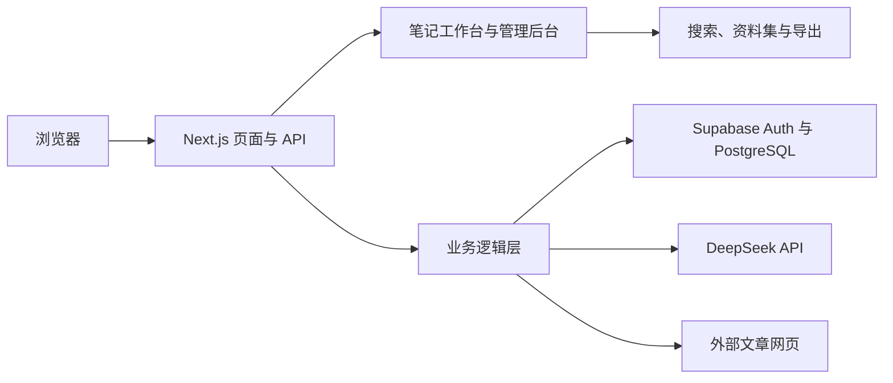

# AI Notes

AI Notes 是一款面向个人阅读与知识管理的全栈 AI 笔记应用。它将网页收藏、正文提取、AI 结构化分析、追问和资料集整理放进同一条工作流，帮助用户把阅读内容沉淀为可检索、可复用的知识。

## 功能概览

### 阅读与笔记

- 使用邮箱和密码注册、登录，并在工作台创建、编辑和管理笔记。
- 通过来源 URL 导入文章，按 Readability、JSON-LD 和 DOM 规则提取正文；需要时使用本机浏览器渲染作为兜底。
- 使用标签和生命周期状态整理内容：待整理、已提炼、已归档。
- 按标题、标签、来源链接、正文和 AI 分析结果搜索笔记。

### AI 阅读助手

- 对单篇笔记生成结构化分析，包含主题、核心观点、论据、适用场景和要点。
- 围绕单篇笔记继续提问，或选择多篇资料进行综合问答；一次最多选择 5 篇。
- 将 AI 分析结果保存在笔记中，在工作台直接查看并继续使用。

### 资料集与导出

- 将多篇笔记组成当前资料集，并将常用资料集保存、载入、更新或删除。
- 将单篇 AI 分析导出为 Markdown、JSON 或 HTML，也可以将多篇分析打包为 ZIP。

### 管理与权限

- 管理员可查看用户和笔记、按用户及笔记状态筛选，并管理其他用户的角色。
- 普通用户只能访问自己的笔记；数据库通过 Supabase Row Level Security（RLS）执行数据隔离。
- 管理员不能修改自己的角色，也不能降级系统中的最后一位管理员。

## 技术栈

| 层次 | 技术 |
| --- | --- |
| Web 应用 | Next.js 16 App Router、React 19、TypeScript |
| 身份与数据 | Supabase Auth、PostgreSQL、Row Level Security |
| AI 服务 | DeepSeek API，通过 OpenAI 兼容 SDK 调用 |
| 网页正文提取 | Mozilla Readability、JSDOM、Playwright Core |
| 测试与代码检查 | Vitest、React Testing Library、ESLint、TypeScript |

## 架构



```text
app/                  页面与 API 路由
  auth/               登录和注册
  dashboard/          用户工作台与管理后台
  api/                AI、文章导入、管理员接口
components/           工作台、AI 面板、表单与后台组件
lib/                  认证、Supabase、AI、导入、检索和导出逻辑
supabase/
  setup/              全新数据库初始化脚本
  migrations/         增量数据库迁移
tests/                单元测试与 API、组件集成测试
docs/                 架构、测试和工程文档
```

## 本地运行

### 环境要求

- Node.js 20.9 或更高版本
- npm
- 一个 Supabase 项目
- 一个 DeepSeek API Key
- 可选：Chrome、Chromium 或 Edge，用于动态网页的浏览器渲染兜底

### 安装依赖

```bash
git clone https://github.com/palmer67/ai-note.git
cd ai-note
npm ci
```

在项目根目录创建 `.env.local`，可以从模板开始：

```bash
cp .env.example .env.local
```

PowerShell 中可运行：

```powershell
Copy-Item .env.example .env.local
```

配置以下服务端与 Supabase 环境变量：

```env
NEXT_PUBLIC_SUPABASE_URL=https://your-project-ref.supabase.co
NEXT_PUBLIC_SUPABASE_PUBLISHABLE_KEY=your_supabase_publishable_key
DEEPSEEK_API_KEY=your_deepseek_api_key

# 可选；未设置时使用下列默认值
DEEPSEEK_BASE_URL=https://api.deepseek.com
DEEPSEEK_MODEL=deepseek-v4-flash
```

`NEXT_PUBLIC_SUPABASE_ANON_KEY` 可用于兼容已有配置。Supabase publishable/anon key 会用于客户端初始化；不要把 Supabase `service_role` key 或 DeepSeek API Key 放进 `NEXT_PUBLIC_*` 变量或提交到仓库。

### 初始化 Supabase

对于**全新的 Supabase 项目**，在 Supabase Dashboard 的 SQL Editor 中执行：

- [`supabase/setup/ai-notes-fresh-bootstrap.sql`](./supabase/setup/ai-notes-fresh-bootstrap.sql)

脚本会设置应用所需的表、触发器、函数、索引和 RLS 策略。对于已经存有数据的项目，不要把初始化脚本当作重置脚本使用；先备份数据库，再检查已应用的迁移，仅按时间顺序执行缺少的迁移：

1. [`20260508000000_init.sql`](./supabase/migrations/20260508000000_init.sql)
2. [`20260508010000_profiles-self-heal.sql`](./supabase/migrations/20260508010000_profiles-self-heal.sql)
3. [`20260508020000_bootstrap_repair.sql`](./supabase/migrations/20260508020000_bootstrap_repair.sql)
4. [`20260508030000_atomic_role_update.sql`](./supabase/migrations/20260508030000_atomic_role_update.sql)
5. [`20260511090000_add_note_lifecycle_status.sql`](./supabase/migrations/20260511090000_add_note_lifecycle_status.sql)
6. [`20260512100000_lock_profile_role_updates.sql`](./supabase/migrations/20260512100000_lock_profile_role_updates.sql)
7. [`20260519090000_add_saved_note_collections.sql`](./supabase/migrations/20260519090000_add_saved_note_collections.sql)

在 Supabase Auth 的 URL Configuration 中，将本地地址（`http://localhost:3000`）及实际部署域名配置为 Site URL / Redirect URLs。若启用了邮箱验证，新用户需要先完成邮箱验证再登录。

### 创建第一个管理员

先通过应用注册管理员账号，然后在 Supabase SQL Editor 中将该账号提升为管理员。将邮箱替换为实际注册邮箱：

```sql
update public.profiles
set role = 'admin'
where email = 'you@example.com';
```

退出后重新登录即可载入管理员权限。之后的角色调整应通过应用管理后台完成。

### 启动开发服务器

```bash
npm run dev
```

打开 [http://localhost:3000](http://localhost:3000)。

## 校验与生产运行

```bash
npm run lint
npx tsc --noEmit
npm run test:run
npm run build
```

生产环境构建并启动：

```bash
npm ci
npm run build
npm run start
```

部署时在运行平台配置上述环境变量，并在 Supabase Auth 中加入部署域名。动态网页导入的浏览器渲染兜底需要运行环境中存在 Chrome、Chromium 或 Edge；如果浏览器不在默认路径，可配置 `BROWSER_EXECUTABLE_PATH`。普通网页正文提取不依赖该兜底。

## 安全说明

- 笔记与资料集访问由 Supabase RLS 限制；不要关闭 RLS 来绕过授权问题。
- Supabase publishable/anon key 是客户端配置，不等于服务端密钥；表访问仍需由 RLS 策略保护。
- DeepSeek API Key 仅由服务端 API 路由读取。不要提交 `.env.local`、服务角色密钥或模型密钥。
- URL 导入会访问用户提供的外部网页；导入逻辑包含 URL 安全校验与重定向检查。

## 文档

- [架构文档索引](./docs/architecture/README.md)
- [认证与会话](./docs/architecture/01-auth-and-session.md)
- [用户工作台](./docs/architecture/02-user-workspace.md)
- [管理后台](./docs/architecture/03-admin-backoffice.md)
- [AI、导入、导出与检索](./docs/architecture/04-ai-import-export.md)
- [数据库与 RLS](./docs/architecture/05-database-and-rls.md)
- [测试规范](./docs/testing/test-strategy.md)
- [工程工作流](./docs/workflow/engineering-playbook.md)
- [Git 约定](./docs/workflow/git-playbook.md)
