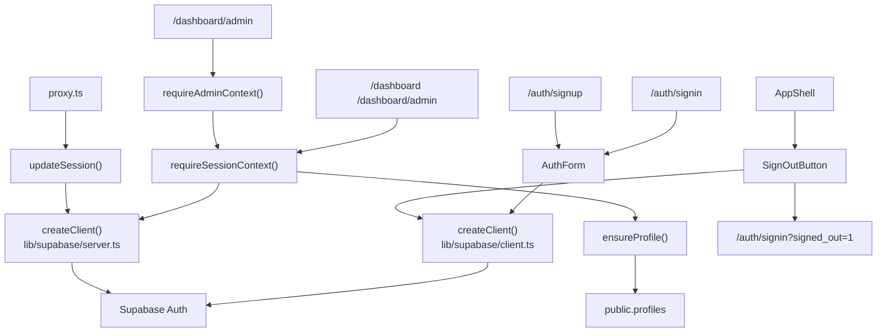

# 模块：认证与会话

## 覆盖范围

- `app/auth/signin/page.tsx`
- `app/auth/signup/page.tsx`
- `components/forms/auth-stage.tsx`
- `components/forms/auth-form.tsx`
- `components/forms/sign-out-button.tsx`
- `components/layout/app-shell.tsx`
- `lib/auth.ts`
- `lib/supabase/client.ts`
- `lib/supabase/server.ts`
- `lib/supabase/config.ts`
- `lib/supabase/middleware.ts`
- `proxy.ts`

## 模块职责

- 提供登录、注册、退出登录 UI。
- 在服务端页面入口校验用户会话，并补齐 `profiles` 业务资料。
- 在浏览器和服务端分别创建 Supabase Client。
- 通过 `proxy.ts` 刷新 Supabase 会话 Cookie。
- 在布局层展示当前登录邮箱、角色以及管理员入口。

## 架构图

## 关键数据流

1. 登录和注册都在浏览器端通过 Supabase JS SDK 直接完成。
2. 进入受保护页面时，服务端通过 `requireSessionContext()` 获取 Supabase 用户信息。
3. 如果 `public.profiles` 缺失，会由 `ensureProfile()` 自动补建业务资料。
4. 管理员页面额外通过 `requireAdminContext()` 判断 `profile.role`。
5. 退出登录由前端触发 `supabase.auth.signOut()`，然后跳回登录页并带上退出来源参数。

## 边界说明

- 认证身份来自 `auth.users`，业务角色来自 `public.profiles`。
- 页面是否可见由服务端守卫决定，不依赖前端路由拦截。
- 浏览器端只负责发起认证动作，不负责鉴权裁决。

## 当前实现评价

- 优点：简单、链路清楚，符合 Next.js + Supabase 的常见集成方式。
- 约束：`lib/auth.ts` 兼顾鉴权和资料补建，职责略重；后续如果用户资料逻辑继续增长，建议拆成 `auth guard` 与 `profile bootstrap` 两层。
