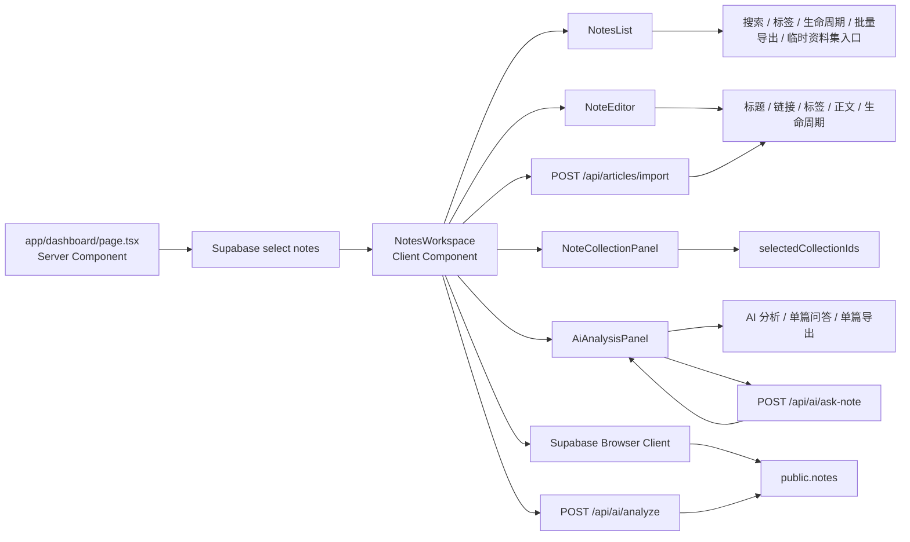

# 模块：用户工作台

## 覆盖范围

- `app/dashboard/page.tsx`
- `components/notes/notes-workspace.tsx`
- `components/notes/notes-list.tsx`
- `components/notes/note-editor.tsx`
- `components/notes/ai-analysis-panel.tsx`
- `components/notes/note-collection-panel.tsx`
- `lib/note-lifecycle.ts`
- `lib/tags.ts`
- `lib/note-ai-status.ts`

## 模块职责

- 加载当前用户的全部笔记。
- 在客户端管理当前选中文章、草稿、搜索、标签筛选、生命周期视图、资料集、批量导出状态。
- 提供笔记的增删改、生命周期切换、URL 导入、AI 分析、单篇问答、批量导出等入口。

## 架构图

## 状态划分

`NotesWorkspace` 当前集中维护以下状态：

- 数据状态：`notes`、`selectedId`、`draft`
- 检索状态：`search`、`activeTag`、`activeLifecycleView`
- 操作状态：`savePending`、`deletePending`、`analysisPending`、`importPending`
- 批量导出状态：`batchMode`、`selectedExportIds`、`batchFeedback`
- 临时资料集状态：`selectedCollectionIds`
- 页面反馈状态：`feedback`、`analysisError`

## 当前实现评价

- 优点：所有主流程都能在一个组件里顺着读下来，学习成本低。
- 主要问题：`[notes-workspace.tsx](</C:/Users/cmd41/Documents/New project/components/notes/notes-workspace.tsx:1>)` 已达约 500 行，状态切换、远程调用和视图拼装耦合在一起，后续继续加功能时会越来越难测。

## 推荐拆分方向

优先级从高到低：

1. 提取 `useNotesWorkspaceState()`：集中管理筛选、选择、临时资料集和批量导出状态。
2. 提取 `useNoteMutations()`：集中管理保存、删除、状态切换、导入、分析这些副作用。
3. 把纯计算逻辑下沉到 `lib/notes/*`，例如筛选、排序、统计和选择同步。

## 不建议现在做的事

- 现在不需要引入 Zustand、Redux 之类的全局状态库。
- 现在不需要把工作台拆成多页面工作流，当前单页工作台仍然是合理选择。
