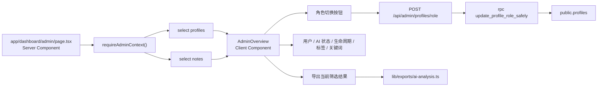

# 模块：管理后台

## 覆盖范围

- `app/dashboard/admin/page.tsx`
- `components/admin/admin-overview.tsx`
- `app/api/admin/profiles/role/route.ts`

## 模块职责

- 展示全局用户列表和全局笔记列表。
- 调整其他用户角色。
- 按用户、AI 状态、生命周期状态、标签和关键词筛选全部笔记。
- 导出当前筛选结果中的 AI 分析。

## 架构图

## 关键实现点

- 页面入口完全服务端鉴权，普通用户无法进入组件层。
- 角色变更通过数据库 RPC 保证“不能降级最后一个管理员”。
- 标签筛选依赖当前筛选结果动态生成，并在失效时主动重置。

## 当前实现评价

- 优点：权限边界清晰，关键安全约束已经落在数据库函数而不是前端。
- 主要问题：`[admin-overview.tsx](</C:/Users/cmd41/Documents/New project/components/admin/admin-overview.tsx:1>)` 已接近 500 行，用户管理、笔记筛选、导出和局部文案反馈都耦合在一个客户端组件中。

## 推荐拆分方向

1. 提取 `AdminUserTable` 和 `AdminNotesTable` 两个子容器。
2. 提取 `useAdminNoteFilters()`，统一筛选状态和“标签失效重置”逻辑。
3. 把后台关键词搜索与工作台搜索统一到共享 helper，避免两边语义漂移。

## 注意事项

- 角色修改仍然应该只通过 RPC，不要改回前端预检查 + 普通 update。
- 管理后台目前默认一次性加载全量数据；如果笔记量继续增长，需要引入分页或服务端筛选。
