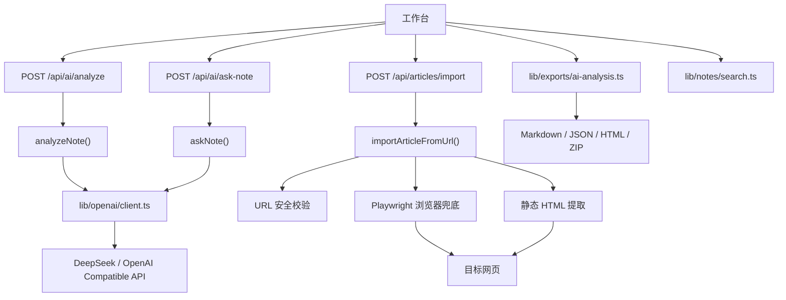

# 模块：AI、导入、导出与检索

## 覆盖范围

- `app/api/ai/analyze/route.ts`
- `app/api/ai/ask-note/route.ts`
- `app/api/articles/import/route.ts`
- `lib/openai/client.ts`
- `lib/openai/analyze-note.ts`
- `lib/openai/ask-note.ts`
- `lib/articles/import-from-url.ts`
- `lib/exports/ai-analysis.ts`
- `lib/notes/search.ts`

## 模块职责

- 对单篇笔记执行结构化 AI 分析。
- 对单篇笔记执行后续问答。
- 从外部 URL 抓取文章标题和正文。
- 将 AI 分析结果导出为 Markdown、JSON、HTML 或 ZIP。
- 为工作台提供统一搜索文本拼接逻辑。

## 架构图

## 子链路说明

### AI 分析

- API 负责鉴权、读取笔记、回写 `ai_summary` 与 `ai_status`。
- `analyzeNote()` 负责 Prompt、结构化 JSON 解析和归一化。
- `runModelRequest()` 负责有限重试和可读错误转换。

### 单篇问答

- 不回写数据库，只返回一段答案。
- 输入上下文由标题、来源、标签、正文和已有摘要共同组成。

### URL 导入

- 先执行 URL 安全校验和重定向安全校验。
- 先尝试静态提取，再在失败或挑战页场景下走浏览器兜底。
- 浏览器兜底带有单进程并发锁和超时保护。

### 导出

- 完全在前端执行，不依赖额外后端接口。
- 三种单文件格式都由同一个归一化 payload 生成。

## 当前实现评价

- 优点：链路完整，安全约束已经比普通 Demo 更扎实。
- 主要问题：
  - `[import-from-url.ts](</C:/Users/cmd41/Documents/New project/lib/articles/import-from-url.ts:1>)` 超过 600 行，同时承担 SSRF 防护、HTML 清洗、正文评分、浏览器兜底和超时控制，职责过多。
  - AI 服务层还没有抽象出统一的“模型任务接口”，未来切模型或加多篇问答时会继续复制结构。

## 推荐拆分方向

1. `lib/articles/url-safety.ts`
2. `lib/articles/static-extractors.ts`
3. `lib/articles/rendered-fallback.ts`
4. `lib/articles/content-scoring.ts`
5. `lib/openai/tasks/*` 或 `lib/ai/tasks/*`，把分析、问答、多篇问答统一为任务接口
