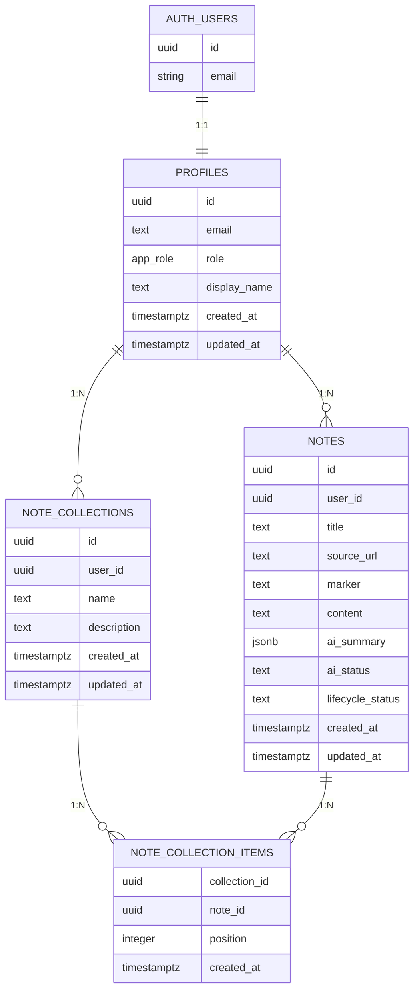
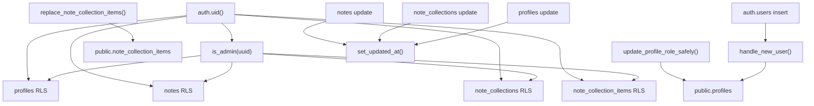

# 模块：数据库与权限模型

## 覆盖范围

- `supabase/migrations/20260508000000_init.sql`
- `supabase/migrations/20260508030000_atomic_role_update.sql`
- `supabase/migrations/20260511090000_add_note_lifecycle_status.sql`
- `supabase/migrations/20260519090000_add_saved_note_collections.sql`
- `lib/types.ts`
- `lib/tags.ts`
- `lib/note-lifecycle.ts`

## 数据模型图

## 权限与约束图

## 关键约束

- `profiles.id` 与 `auth.users.id` 绑定，删除认证用户会级联删除资料。
- `notes.user_id` 指向 `profiles.id`，删除资料会级联删除笔记。
- `notes.ai_status` 目前允许：`idle / loading / done / error`
- `notes.lifecycle_status` 目前允许：`inbox / distilled / archived`
- `note_collections.user_id` 指向 `profiles.id`，删除用户会级联删除保存资料集。
- `note_collection_items` 用 `(collection_id, note_id)` 作为主键，删除资料集或笔记都会自动清理成员关系。
- `note_collection_items.position` 保存资料集内的笔记顺序。

## RLS 规则摘要

### `public.profiles`

- 普通用户可读自己的资料。
- 管理员可读全部资料。
- 用户可创建自己的资料。
- 用户可更新自己的资料。
- 管理员可更新全部资料。

### `public.notes`

- 普通用户只能访问自己的笔记。
- 管理员可查看全部笔记。
- 普通用户只能创建、修改、删除自己的笔记。

### `public.note_collections`

- 普通用户只能访问自己的保存资料集。
- 管理员可查看全部保存资料集。
- 创建、更新、删除时必须满足资料集归属约束。

### `public.note_collection_items`

- 普通用户只能访问自己资料集里的成员关系。
- 成员写入时同时校验资料集和笔记都属于当前用户。
- 管理员可查看全部成员关系。

## RPC 与触发器

- `handle_new_user()`：新注册用户自动补建 `profiles`
- `set_updated_at()`：统一刷新 `updated_at`
- `is_admin(uuid)`：RLS 和业务逻辑里的管理员判断
- `update_profile_role_safely()`：原子化修改角色并防止系统失去最后一个管理员
- `replace_note_collection_items()`：原子化替换某个保存资料集的成员列表，并显式校验资料集和笔记归属

## 当前实现评价

- 优点：真正把权限约束放进了数据库，而不是只靠前端按钮隐藏。
- 主要问题：TypeScript 侧仍然使用手写接口 `[types.ts](</C:/Users/cmd41/Documents/New project/lib/types.ts:1>)`，没有使用 Supabase 生成类型，因此查询结果里仍然需要少量类型断言。

## 推荐演进

1. 引入 Supabase 生成的 Database Types。
2. 为 `notes` 查询定义更明确的 typed repository 或 query helpers。
3. 当 `marker` 未来演进成真正标签表时，再考虑把标签从 `text` 列迁移为关系模型；当前阶段没必要过早拆表。
