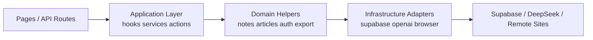

# 架构审查与优化建议

这份文档只回答一个问题：基于当前代码规模，哪些地方值得优化，哪些地方暂时不用动。

## 当前结论

当前架构还能继续支撑下一阶段开发，但已经出现三个明显信号：

- 核心客户端组件过大。
- 导入链路过于集中。
- 自动化测试缺位，后续改动成本会迅速上升。

这意味着下一个阶段不该优先做“大重构”，而应该做有边界的结构化收口。

## 优先级建议

| 优先级 | 项目 | 现状 | 风险 | 建议 |
| --- | --- | --- | --- | --- |
| P1 | 工作台状态拆分 | `notes-workspace.tsx` 约 504 行 | 功能继续堆叠后难测、难改 | 拆 `useNotesWorkspaceState` 和 `useNoteMutations` |
| P1 | 导入模块拆分 | `import-from-url.ts` 约 602 行 | 安全、抓取、评分和浏览器兜底耦合 | 拆成安全校验、静态提取、浏览器兜底、评分四层 |
| P1 | 测试基线 | 当前只有 `lint + tsc` | 回归风险高 | 先建立单元和 API 集成测试基线 |
| P2 | 管理后台拆分 | `admin-overview.tsx` 约 483 行 | 筛选、导出、角色管理耦合 | 拆分用户表、笔记表、筛选 hook |
| P2 | 数据库类型化 | 存在 `as unknown as Note` | 查询结果和模型可能漂移 | 引入 Supabase 生成类型 |
| P2 | 搜索语义统一 | 工作台与后台搜索 helper 不一致 | 行为偏差、维护重复 | 建立共享搜索拼装层 |
| P3 | 样式模块化 | 视觉集中在 `app/globals.css` | 长期可维护性下降 | 只有在样式继续暴涨时再考虑拆分 |

## 目标分层图

## 建议的近期重构顺序

1. 先补测试，不先做大重构。没有测试保护的重构只会放大风险。
2. 再拆工作台，因为它是日常变更最频繁的模块。
3. 然后拆导入模块，因为它最复杂、最容易引发边缘问题。
4. 最后处理后台和类型化收口。

## 暂时不要做的事

- 不要改成多仓库或微服务。
- 不要为当前规模引入全局状态库。
- 不要把所有 Supabase 调用机械地包一层 repository；只有查询模式开始重复时再抽象。

## 进入下一阶段前的最低要求

- 补一套自动化测试文档并开始实现基础测试。
- 每次新增核心能力时同步更新模块文档。
- 新的复杂逻辑尽量放进 `lib/*` 或 hook，不再继续堆进超大组件。
