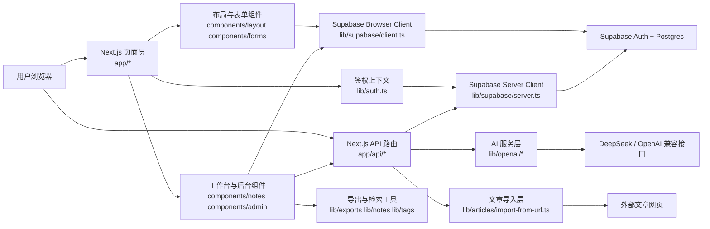

# 架构文档索引

这组文档描述 `AI Notes` 当前的代码架构、模块边界、数据流和后续可优化点。

当前项目是一个单仓库的 Next.js 全栈应用，前端页面、后端接口、Supabase 集成、AI 调用和导入导出逻辑都放在同一代码库里。它的优点是学习成本低、链路清晰；它的代价是部分模块已经开始变大，后续需要更明确的分层。

## 系统总览图

## 模块索引

| 模块 | 文档 | 代码范围 |
| --- | --- | --- |
| 认证与会话 | [01-auth-and-session.md](./01-auth-and-session.md) | `app/auth/*` `components/forms/*` `components/layout/*` `lib/auth.ts` `lib/supabase/*` `proxy.ts` |
| 用户工作台 | [02-user-workspace.md](./02-user-workspace.md) | `app/dashboard/page.tsx` `components/notes/*` |
| 管理后台 | [03-admin-backoffice.md](./03-admin-backoffice.md) | `app/dashboard/admin/page.tsx` `components/admin/admin-overview.tsx` `app/api/admin/profiles/role/route.ts` |
| AI、导入、导出与检索 | [04-ai-import-export.md](./04-ai-import-export.md) | `app/api/ai/*` `app/api/articles/import/route.ts` `lib/openai/*` `lib/articles/*` `lib/exports/*` `lib/notes/search.ts` |
| 数据库与权限模型 | [05-database-and-rls.md](./05-database-and-rls.md) | `supabase/migrations/*` `lib/types.ts` `lib/note-lifecycle.ts` `lib/tags.ts` |
| 架构审查与优化建议 | [06-architecture-review.md](./06-architecture-review.md) | 面向全仓库 |
| 测试规范 | [../testing/test-strategy.md](../testing/test-strategy.md) | 面向全仓库 |

## 当前架构特征

- 采用 Next.js App Router，页面和 API 路由共仓。
- 认证和数据库都依赖 Supabase，权限控制主要靠 RLS 和少量服务端守卫。
- 页面层大量依赖客户端组件，尤其工作台和后台都持有较多本地交互状态。
- API 路由保持薄层，复杂逻辑主要下沉到 `lib/*`。
- 导入、AI、导出都已经具备真实业务闭环，但自动化测试尚未建立。

## 推荐阅读顺序

1. 先读 [01-auth-and-session.md](./01-auth-and-session.md) 和 [05-database-and-rls.md](./05-database-and-rls.md)，建立鉴权和数据边界认知。
2. 再读 [02-user-workspace.md](./02-user-workspace.md) 和 [03-admin-backoffice.md](./03-admin-backoffice.md)，理解主要 UI 与状态流。
3. 然后读 [04-ai-import-export.md](./04-ai-import-export.md)，掌握 AI 与内容处理链路。
4. 最后看 [06-architecture-review.md](./06-architecture-review.md) 和 [../testing/test-strategy.md](../testing/test-strategy.md) 作为后续演进指北。

## 维护规则

- 新增功能时，如果修改了模块边界、关键数据流或权限模型，需要同步更新对应文档。
- 出现新的核心目录时，先补模块文档，再继续扩展功能。
- 代码重构后，如果图和代码不一致，优先修文档，不要让文档长期失效。
