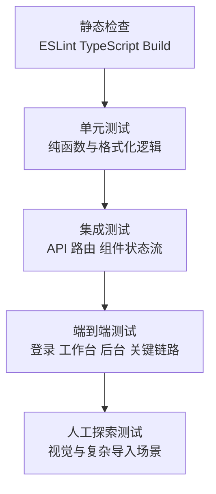

# AI Notes 测试规范

## 目标

这份文档定义 `AI Notes` 的测试分层、工具选择、最小覆盖范围和每次迭代的验收标准。

当前项目已经有真实业务闭环，但自动化测试仍为空白。接下来应该把测试建设成固定流程，而不是每次功能完成后临时手测。

## 当前状态

- 已有：
  - `npm run lint`
  - `tsc --noEmit`
  - `vitest` 测试底座
  - 第一批稳定模块和同步组件测试
  - 第二批核心 API 路由测试
  - 第三批关键组件集成测试
  - 人工手测
- 缺失：
  - API 集成测试
  - 端到端测试
  - 数据迁移回归测试

## 测试分层



## 推荐工具

| 层级 | 工具 | 目标 |
| --- | --- | --- |
| 静态检查 | `eslint` `tsc` `next build` | 语法、类型、构建完整性 |
| 单元测试 | `vitest` | 测纯函数、归一化、格式化和小型服务逻辑 |
| 组件测试 | `@testing-library/react` + `vitest` | 测组件交互、状态切换、反馈文案 |
| API 集成测试 | `vitest` + mock Supabase / mock OpenAI | 测 route handler 鉴权、参数校验、错误分支 |
| E2E | `playwright` | 测用户视角主链路 |
| SQL 验证 | Supabase 本地或测试项目 + 固定 SQL 检查 | 测迁移、RLS、RPC |

## 覆盖矩阵

### 1. 认证与会话

- 登录成功、失败、退出登录
- 未登录访问 `/dashboard` 跳转登录页
- 普通用户访问 `/dashboard/admin` 被重定向
- `signed_out=1` 反馈文案正确

### 2. 用户工作台

- 新建、编辑、删除笔记
- 生命周期状态更新后刷新仍保留
- 搜索与标签、生命周期视图可组合
- 临时资料集添加、移除、清空、删除同步
- 批量导出模式与资料集选择不混用

### 3. 管理后台

- 查看全部用户和全部笔记
- 管理员修改普通用户角色
- 当前管理员不能修改自己
- 最后一个管理员不能被降级
- 后台筛选和导出行为正确

### 4. AI 与导入

- 单篇 AI 分析成功、失败、繁忙重试
- 单篇问答成功、失败、空问题校验
- URL 导入正常网页
- URL 导入挑战页或动态页兜底
- 并发增强导入时返回“稍后再试”

### 5. 导出与检索

- Markdown / JSON / HTML 导出内容完整
- 批量 ZIP 内文件结构正确
- 搜索可命中标题、标签、来源、正文、AI 摘要

### 6. 数据库与权限

- 新注册用户自动补建 `profiles`
- 用户只能访问自己的笔记
- 管理员可查看全部笔记
- `update_profile_role_safely()` 的约束正确

## 每次 PR 的最低门槛

在没有完整自动化测试之前，每个 PR 至少要满足：

1. `npm run lint`
2. `tsc --noEmit`
3. `npm run test:run`
4. `next build`
5. 与改动模块对应的人工冒烟测试
6. README 或相关文档同步更新

## 建议的自动化落地顺序

### 第 1 阶段：先补纯函数和最稳定模块

- `lib/tags.ts`
- `lib/note-lifecycle.ts`
- `lib/note-ai-status.ts`
- `lib/notes/search.ts`
- `lib/exports/ai-analysis.ts` 的格式生成函数
- `components/forms/auth-stage.tsx`

当前阶段已完成以上测试底座与首批用例落地。

### 第 2 阶段：补 API 路由测试

- `/api/ai/analyze`
- `/api/ai/ask-note`
- `/api/articles/import`
- `/api/admin/profiles/role`

当前阶段完成后，以上 4 条核心 API 路由应至少覆盖登录态、参数校验、资源不存在、成功路径和失败路径。

### 第 3 阶段：补组件集成测试

- `NotesWorkspace`
- `AdminOverview`
- `AuthForm`

当前阶段完成后，以上组件应至少覆盖关键状态反馈、筛选联动、资料集交互和角色操作回填。

### 第 4 阶段：补 Playwright 冒烟 E2E

- 登录 -> 新建笔记 -> AI 分析 -> 导出
- 管理员登录 -> 改角色 -> 查看后台筛选

## 手工测试模板

当某个功能还没有自动化测试时，PR 描述里至少记录：

- 测试环境：本地 / Supabase 项目 / 模型配置
- 测试路径：从哪个页面开始，执行哪些动作
- 预期结果：页面反馈、数据库变化、导出结果
- 实际结果：是否通过，是否存在残余风险

## 目录建议

未来补测试代码时，建议采用：

```text
tests/
  unit/
    lib/
  integration/
    api/
    components/
  e2e/
```

## 维护规则

- 新增 `lib/*` 纯函数时，优先补单元测试。
- 新增 API 路由时，至少补参数校验和失败分支测试。
- 新增跨模块工作流时，至少补一条 E2E 冒烟用例。
- 如果模块边界发生变化，要同步更新 [../architecture/README.md](../architecture/README.md)。
